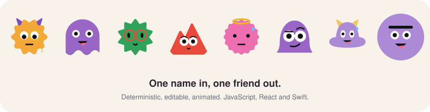
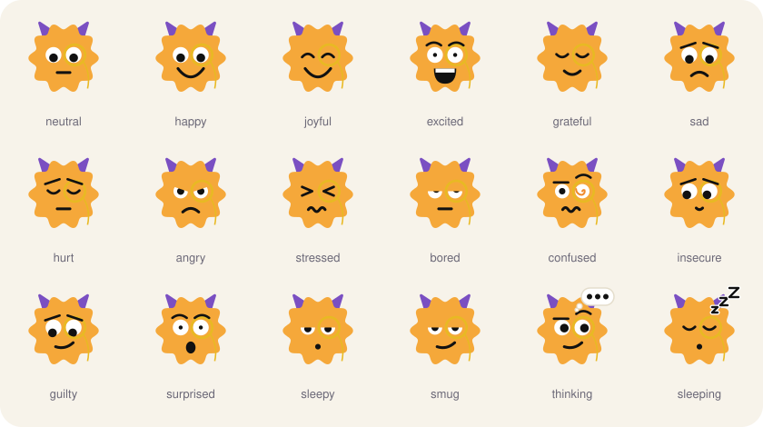

# Blobmates

<p align="center"></p>

Friendly blob avatars that feel alive. Give it any string (a username, an email, a bot name) and it always draws the same character: shape, color, eyes, mouth and sometimes an accessory. Then you can make it blink, follow the pointer, wander around and react to taps.

- **Deterministic.** The same string gives the same Blobmate everywhere.
- **Editable.** Pin any single thing (shape, color, eyes, mouth, glasses, a bow) and let the name decide the rest.
- **Expressive.** 18 moods, each with its own face and its own motion. `thinking` shows a thought bubble, `sleeping` shows snoring z's.
- **Alive (optional).** Blinking, eyes that follow the pointer, roaming around a box, and a reaction when tapped.
- **Plain SVG.** Static avatars are just an SVG string, with no dependencies.

**Live site:** https://blobmates.pages.dev

<p align="center"></p>

The site (landing page, use cases, editor and docs) is built with React and lives in `web/`.

## Try it

```bash
cd web
npm install
npm run dev        # development server
npm run build      # static site in web/dist, ready to host anywhere
```

The site uses hash routes (`#/editor`, `#/docs`), so it works on any static host without rewrite rules.

## Using the library

Install it from npm:

```bash
npm install blobmates
```

```js
import { blobmate } from "blobmates";

// Static: returns an SVG string
const svg = blobmate("sagar", { mood: "happy", size: 96 });

// Pin anything you want, the name decides the rest
blobmate("sagar", { body: "cloud", color: "#F4A3C9", eyes: "glasses-round" });
```

React components:

```jsx
import { Blobmate, LiveBlobmate } from "blobmates/react";

<Blobmate seed="sagar" size={64} shape="circle" />
<LiveBlobmate seed="sagar" mood="happy" react />
```

Live avatars (browser only):

```js
import { animate } from "blobmates/runtime";

const rt = animate(document.querySelector("#box"), blobmate, {
  seed: "sagar",
  mood: "happy",
  motion: "follow",      // "none" | "follow" | "idle"
  roam: { speed: 70 },   // optional: wander around inside #box
  react: true,           // optional: jump and change face when tapped
});

rt.set({ mood: "angry" });
rt.poke();               // trigger the tap reaction from code
rt.destroy();
```

The Docs page in the app lists every option and shows copy-paste snippets for React, Vue, Svelte, Angular and plain HTML. The JavaScript, React and HTML snippets are tested against the published package. The Vue, Svelte and Angular ones use the same calls but are not run.

## Swift (Mac and iOS apps)

Add the package (macOS 13+, iOS 16+, no dependencies): in Xcode choose File, Add Package Dependencies and enter `https://github.com/dhri-yama/blobmates`, or in `Package.swift`:

```swift
.package(url: "https://github.com/dhri-yama/blobmates", from: "0.2.0")
```

```swift
import SwiftUI
import Blobmates

struct Example: View {
    @State private var blobmate = BlobmateController()   // optional: lets code poke it

    var body: some View {
        VStack {
            BlobmateView(seed: "sagar", size: 64, options: BlobmateOptions(mood: "happy", shape: .circle))
            LiveBlobmateView(seed: "sagar", size: 120, mood: "excited", react: ReactOptions(), controller: blobmate)
            Button("Done") { blobmate.poke() }
        }
    }
}

let svg = Blobmates.svg(seed: "sagar")                         // the same text the JS library gives
let image = Blobmates.nsImage(seed: "sagar", size: 64)          // NSImage (macOS), uiImage on iOS
let png = Blobmates.pngData(seed: "sagar", pixels: 512)         // for files, sharing, notifications
```

`LiveBlobmateView` takes `roam`, `react`, `motion` and `pins` like the JS runtime. Eyes follow the pointer on the Mac, and everything stops when "Reduce motion" is on.

## How it works

- `core/assets/parts.json` is the single source of truth for the art: bodies, eyes, mouths, brows, accessories, palettes, moods and the per-mood motion numbers. Do not edit it by hand. It is generated by `core/tools/build-parts.mjs`.
- The seed is hashed (FNV-1a) into a small random generator (mulberry32). Choices are drawn in a fixed order with integer math only, so another platform can reproduce them exactly.
- Adding or removing shapes changes which shape some seeds pick. Treat a published set of parts as a version.

```bash
node core/tools/build-parts.mjs   # regenerate core/assets/parts.json
```

## Layout

```
core/                   everything shared, and every language implementation
  assets/parts.json     generated art and mood data
  tools/                build-parts.mjs (generator), serve.mjs (local static server)
  js/src/               core (index.js) and browser runtime (runtime.js)
  js/test/              unit tests
  swift/Sources/        Swift package: Blobmates (library) and BlobmatesCheck (test program)
  spec/                 the contract every port follows: algorithm, motion, stored test vectors
web/                    React site: landing page, use cases, editor, docs
CLAUDE.md               notes for working in this repo (rules that are easy to break)
DESIGN.md               how the site and the avatars should look and move
```

## Status and limits

- Web (JavaScript) and Swift (Mac and iOS) today. A Kotlin port is planned.
- Published to npm as [`blobmates`](https://www.npmjs.com/package/blobmates) (source in `core/js`), with React components and TypeScript types.
- The JavaScript library has unit tests. The Swift package is checked against the same stored test vectors (`core/spec`): 478 pictures byte for byte, drawing against Chrome, and 3900 recorded animation frames. Run `swift run BlobmatesCheck`.
- Live avatars redraw their SVG as they move. They are fine for a handful on a page, not for hundreds.
- A static SVG cannot react or animate on its own. Live behavior needs the runtime.

## Notes on the art

The `togepi` shape is an egg inspired by a Pokémon. Togepi is a Nintendo / The Pokémon Company character, so think before using that shape in anything public or commercial. The dino shapes are original blobs.

## License

MIT. See `LICENSE`.
